# COMP 3613 Assignment 2: Testing the Student Awards App

**Name:** Johnathan Laldeo
**Student ID:** 816046240
**Repository:** https://github.com/JohnathanLaldeo/comp3613a1
**Deployed app (from A1):** https://comp3613a1-1-9j9f.onrender.com

---

## 1. Project description

**Student Awards** (StarServe) is an incentive system for volunteering. Students log the hours they volunteer. An admin reviews each submission and approves or rejects it. A rejection must include a reason. Each approved hour earns one point, and students spend points on prizes from a catalogue. Redeeming a prize deducts its cost from the student's balance and reduces the prize's stock by one.

Main workflows:

1. **Log Volunteer Hours (Student)**: submit date, activity, hours and optional notes. The entry waits for review, and a rejected entry can be resubmitted.
2. **Approve Volunteer Hours (Admin)**: review the pending queue, then approve or reject with a reason.
3. **Redeem Prize (Student)**: browse prizes, confirm the cost against the current balance, and redeem.

Stack: FastAPI, SQLModel, Jinja templates and PostgreSQL on Render (SQLite locally and in tests). Code is layered as Routes → Services (business rules) → Repositories (database access) → Models.

## 2. Use case diagram

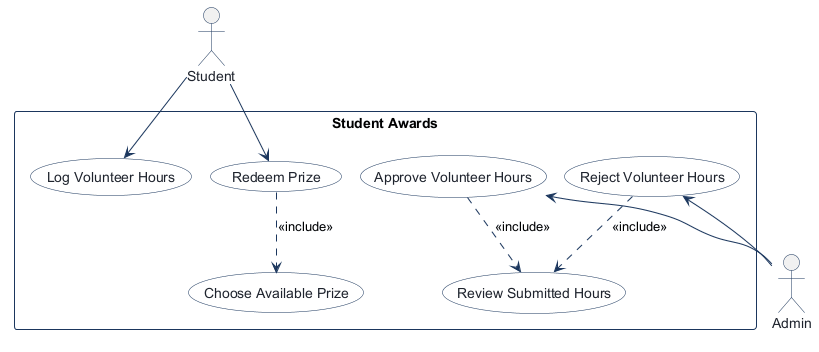

## 3. Entity relationship diagram

``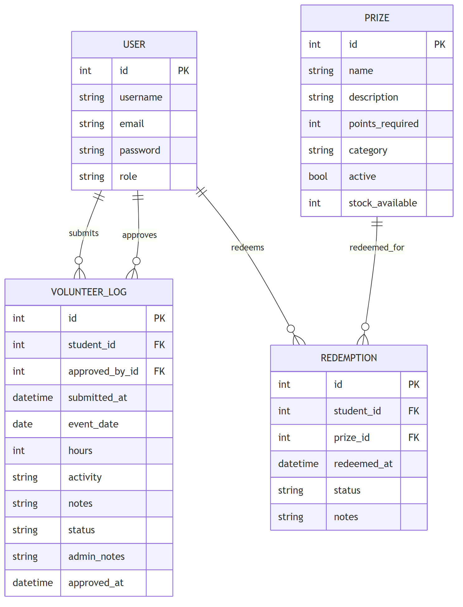``

Points balance = approved hours − sum of `points_required` for the student's redemptions. It is calculated when needed, not stored.

## 4. Application wireframes

| # | Screen | Wireframe |
|---|--------|-----------|
| W1 | Student Dashboard | 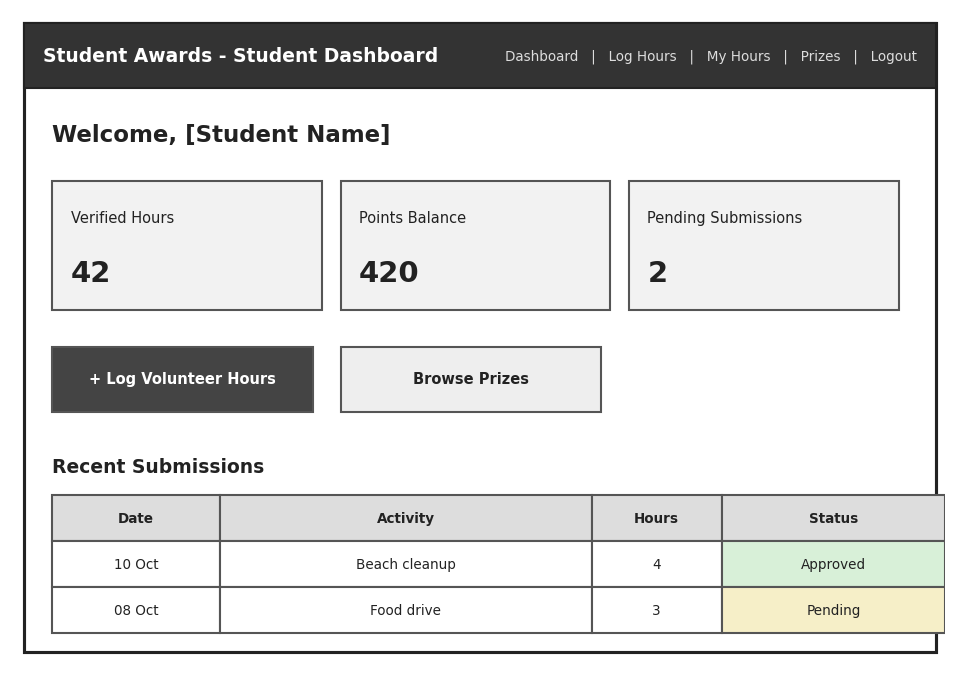 |
| W2 | Log Volunteer Hours | 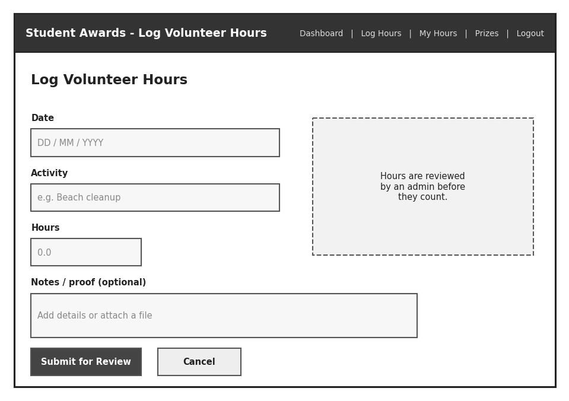 |
| W3 | My Hours | 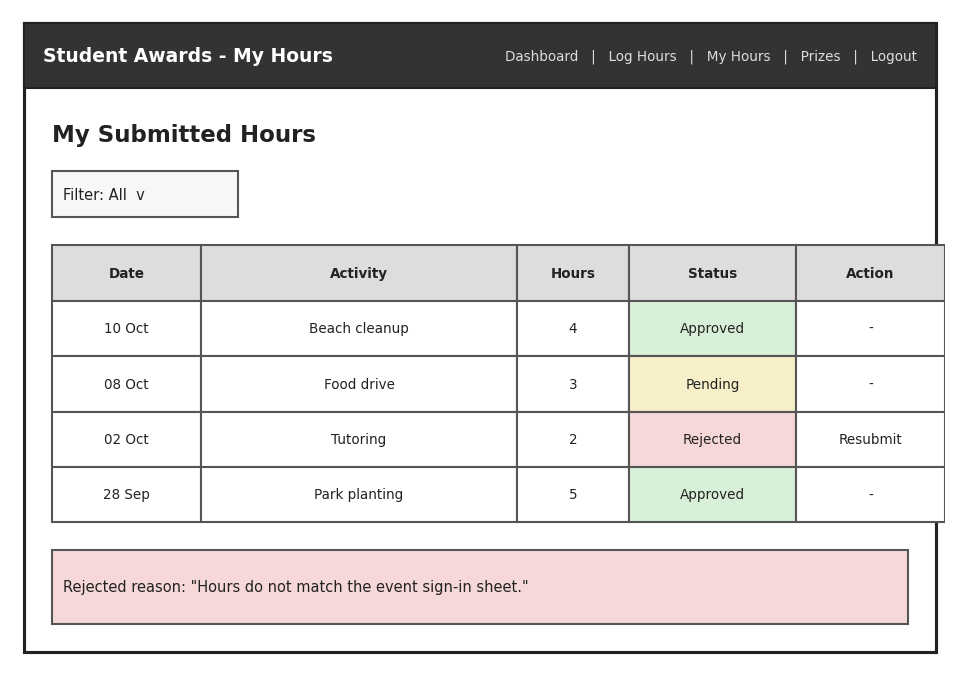 |
| W4 | Available Prizes | 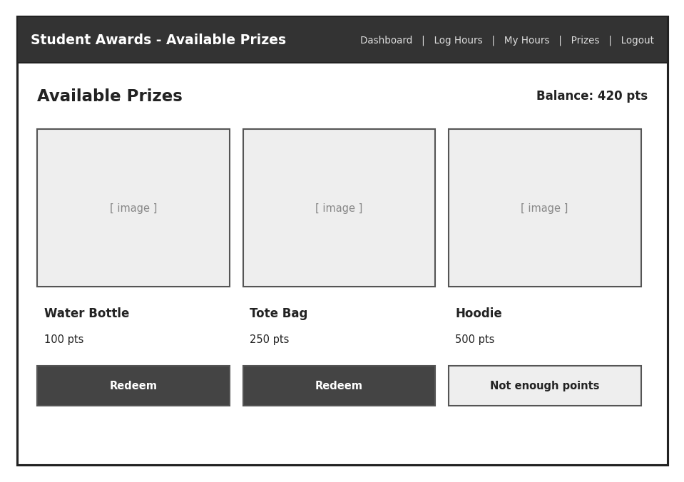 |
| W5 | Confirm Redemption | 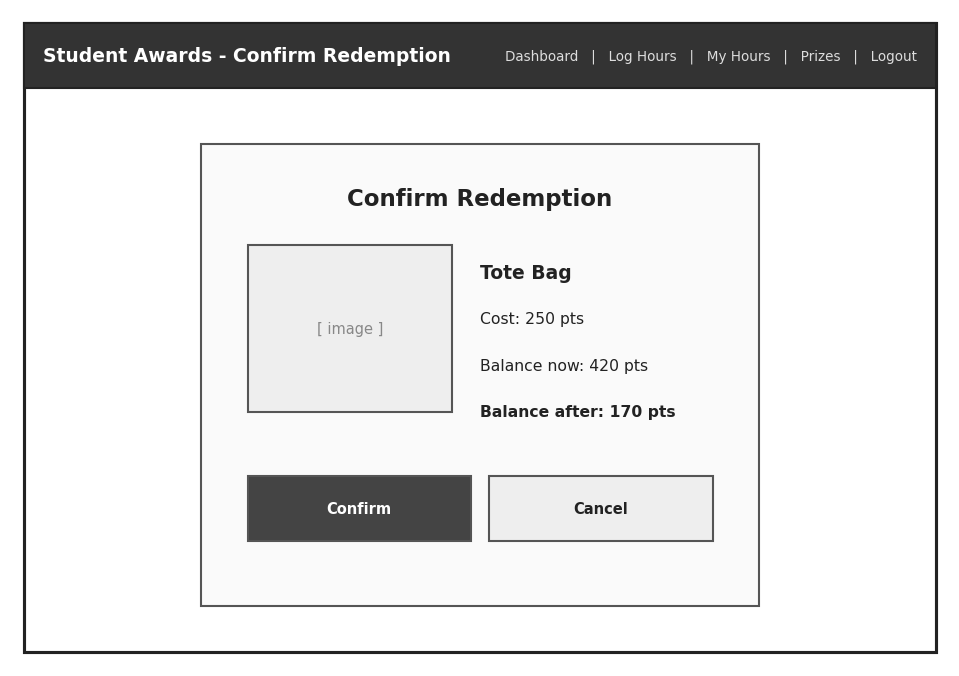 |
| W6 | Admin Dashboard | 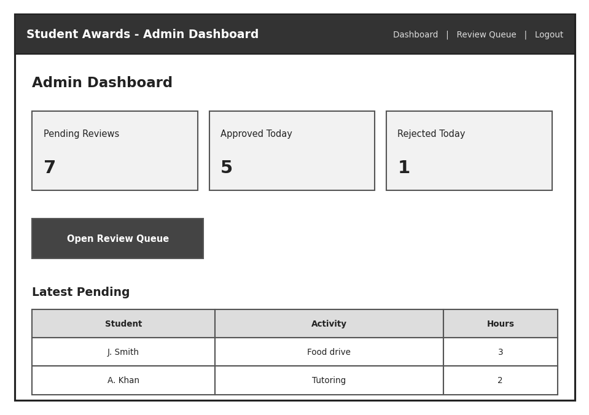 |
| W7 | Review Queue | 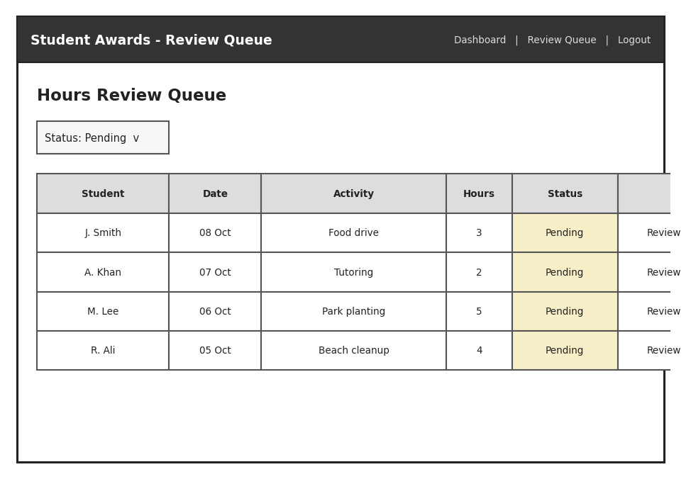 |
| W8 | Review Submission | 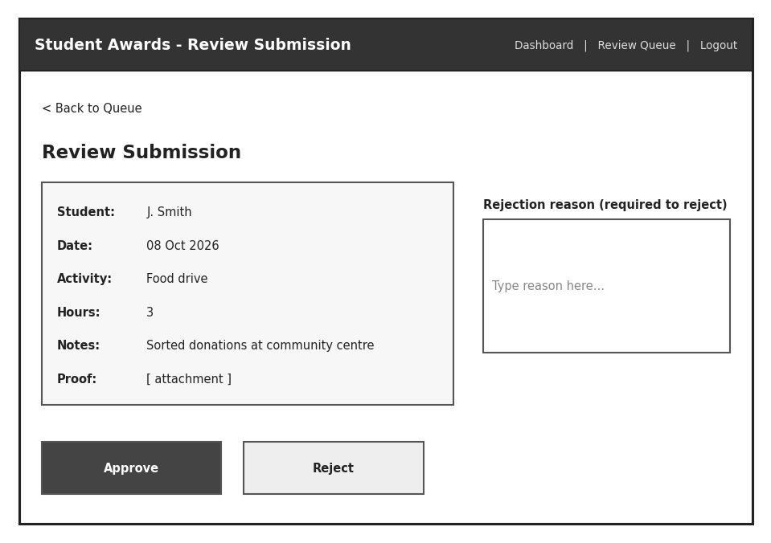 |

---

## 5. Test plans

### 5.1 User Acceptance Test plan

**Setup:** run `python manage.py init` and then `python manage.py run`, and open http://localhost:5000.
Accounts: **bob / bobpass** (student, starts with 6 approved hours and 4 pending) and **admin / adminpass** (admin).
Use two browsers (or one normal and one private window) so the student and the admin can be logged in at the same time.

| ID | Wireframe | User | Task | Success criteria | Actual result | Pass/Fail |
|----|-----------|------|------|------------------|---------------|-----------|
| UAT-1 | W1 | bob | Log in and view the dashboard. | Dashboard shows Welcome bob, Verified Hours **6**, Points Balance **6**, Pending Submissions **1**, the Log Volunteer Hours and Browse Prizes buttons, and a Recent Submissions table with Date, Activity, Hours and Status. | Dashboard showed Welcome bob, Verified Hours 6, Points Balance 6, Pending Submissions 1, both buttons and the Recent Submissions table. | Pass |
| UAT-2 | W2 | bob | Click **+ Log Volunteer Hours**, enter today's date, activity "Beach cleanup", 3 hours, and a note, then click **Submit for Review**. | A success message appears. The new entry shows as **pending** on My Hours, and Pending Submissions on the dashboard goes up by 1. | Success message shown; Beach cleanup (3h) listed as pending on My Hours; Pending Submissions went to 2. | Pass |
| UAT-3 | W2 | bob | Open Log Hours, enter 0 hours (or a blank activity) and submit. Then open the form and click **Cancel**. | The entry is not saved and an error or validation message is shown. Cancel returns to the dashboard without saving. | 0 hours was rejected with a validation message and nothing was saved; Cancel returned to the dashboard. | Pass |
| UAT-4 | W7, W8 | admin | Log in, click **Open Review Queue**, find bob's "Beach cleanup" entry and click **Review**. | The queue lists only pending entries with Student, Date, Activity, Hours and Status. The review page shows the student, date, activity, hours and notes, with Approve and Reject buttons and a rejection-reason box. | Queue listed only pending entries with all columns; review page showed the entry details, Approve/Reject and the reason box. | Pass |
| UAT-5 | W8 | admin | On that entry, click **Reject** with the reason box empty. | The entry is **not** rejected, a "Please provide a rejection reason" message appears, and the entry stays pending. | "Please provide a rejection reason" shown; entry stayed pending. | Pass |
| UAT-6 | W8, W6 | admin | Approve the "Beach cleanup" entry, then go to the Dashboard. | You return to the queue with a success message and the entry is gone from the queue. The dashboard's Approved Today count goes up by 1 and Pending Reviews goes down by 1. | Returned to the queue with a success message; entry removed; Approved Today +1 and Pending Reviews -1. | Pass |
| UAT-7 | W8, W3 | admin, then bob | Admin: reject bob's remaining pending entry with the reason "Hours do not match the sign-in sheet". Bob: open **My Hours**. | The entry shows **rejected** with the reason displayed below the table and a **Resubmit** action. Filter: Rejected shows only rejected entries, and Filter: All shows every entry. | Entry shown as rejected with the reason and a Resubmit link; Rejected filter showed only that entry, All showed every entry. | Pass |
| UAT-8 | W3, W2 | bob | Click **Resubmit** on the rejected entry, change the hours, and submit. | The form opens pre-filled with the rejected entry's details and the rejection reason. After submitting, a new **pending** entry appears on My Hours. | Form opened pre-filled with the reason shown; a new pending entry appeared after submitting. | Pass |
| UAT-9 | W4 | bob | Open **Prizes**. | The balance is shown ("N points available"). Each prize shows name, description, cost and stock. Prizes bob can afford show **Redeem prize**, and the others show **Need more hours**. | "9 points available" shown; prizes listed with cost and stock; affordable ones showed Redeem prize, Festival Pass showed Need more hours. | Pass |
| UAT-10 | W5 | bob | Click **Redeem prize** on an affordable prize, check the confirmation, then click **Cancel**. | The confirmation shows the prize, its cost, Balance now and Balance after (now minus cost). Cancel returns to Prizes with **no** change to balance or stock. | Confirmation showed Cost 4, Balance now 9, Balance after 5; Cancel changed nothing. | Pass |
| UAT-11 | W5, W4, W1 | bob | Redeem the same prize again and click **Confirm**. | A success message appears. The prize now shows **Redeemed**, its stock is down by 1, and the points balance on Prizes and the Dashboard is down by the prize cost. | Success message; Campus Coffee Card showed Redeemed, stock 5 to 4; balance 5 on Prizes and Dashboard. | Pass |
| UAT-12 | W6 | bob | While logged in as bob, go to http://localhost:5000/admin. | Access is refused (401 Unauthorized page) and no admin data is shown. | 401 Unauthorized page shown; no admin data visible. | Pass |

### 5.2 Unit test plan

`AwardService` is tested in isolation, using a `FakeAwardRepository` in place of the database (`tests/test_unit_awards.py`).

| ID | Unit | Input | Expected |
|----|------|-------|----------|
| U1 | create_log | blank activity | ValueError, nothing saved |
| U2 | create_log | hours = 0 | ValueError, nothing saved |
| U3 | create_log | " Beach cleanup ", notes " " | activity trimmed, notes None |
| U4 | decide_log | action "maybe" | ValueError |
| U5 | decide_log | rejected, no notes | ValueError |
| U6 | decide_log | rejected, whitespace notes | ValueError |
| U7 | decide_log | approved, no notes | saved with None notes |
| U8 | redeem_prize | unknown prize | ValueError (NotFoundError) |
| U9 | redeem_prize | hours below cost | ValueError |
| U10 | redeem_prize | hours equal to cost | redemption created |
| U11 | redeem_prize | 8 approved, 5 already spent, cost 5 | ValueError (balance is 3) |

### 5.3 Integration test plan

These run the real app with FastAPI `TestClient` against a fresh SQLite database for each test. Student and admin fixtures log in through `/login` (cookie) or `/api/login` (Bearer token).

**Web flows** (`tests/test_integration_awards.py`)

| ID | Flow | Expected |
|----|------|----------|
| I1 | Student logs hours | log saved as pending |
| I2 | Admin approves it | status approved, student's approved total increases |
| I3 | Admin rejects without reason | blocked, log stays pending |
| I4 | Admin rejects with reason | status rejected, reason saved |
| I5 | Student redeems affordable prize | redemption recorded, stock down by 1 |
| I6 | Student redeems again | refused ("already redeemed") |
| I7 | Student redeems too-expensive prize | refused |
| I8 | Student requests /admin | refused (401) |
| I9 | Anonymous requests /app | refused (401) |
| I10 | Admin dashboard counts | pending, approved today, rejected today are correct |
| I11 | Redeeming spends points | second 5-pt prize refused with 8 hours; page shows 3 points |
| I12 | Admin approves a non-existent log | handled with a message, no server error |
| I21 | My Hours filter, reason, resubmit | filter shows only rejected; reason shown; resubmit form pre-filled |

**REST API** (`tests/test_api_awards.py`)

| ID | Flow | Expected |
|----|------|----------|
| I13 | POST /api/login | 200 with bearer token and role; wrong password 401 |
| I14 | GET /api/logs without token | 401 JSON |
| I15 | Student calls admin endpoints | 403 |
| I16 | POST/GET /api/logs | 201 pending with trimmed activity; hours 0 → 400; list returns own logs |
| I17 | Admin GET/PATCH /api/admin/logs | pending filter; reject without reason 400; bad status 422; missing log 404; approve 200 |
| I18 | GET /api/admin/dashboard | correct counts |
| I19 | POST /api/prizes/{id}/redemptions | 201; again 409; too expensive 400; unknown 404 |
| I20 | Balance, redemptions, prizes | balance 8 → 3 after a 5-pt prize; redemption listed; stock down by 1 |

---

## 6. Implementation

**Repository:** https://github.com/JohnathanLaldeo/comp3613a1

### 6.1 REST API

All endpoints are under `/api`, return JSON and require `Authorization: Bearer <token>` except login.

| Method | Path | Who | Purpose | Success | Errors |
|--------|------|-----|---------|---------|--------|
| POST | /api/login | anyone | Get a token | 200 | 401 |
| GET | /api/logs | student | List my volunteer logs | 200 | 401 |
| POST | /api/logs | student | Log hours | 201 | 400, 401, 422 |
| GET | /api/me/balance | student | Approved hours, points spent, points | 200 | 401 |
| GET | /api/prizes | student | List active prizes | 200 | 401 |
| POST | /api/prizes/{id}/redemptions | student | Redeem a prize | 201 | 400 (not enough points), 404, 409 (already redeemed / out of stock) |
| GET | /api/redemptions | student | List my redemptions | 200 | 401 |
| GET | /api/admin/logs?status= | admin | List logs, optional status filter | 200 | 401, 403, 422 |
| PATCH | /api/admin/logs/{id} | admin | Approve or reject (`{"status", "admin_notes"}`) | 200 | 400, 401, 403, 404, 422 |
| GET | /api/admin/dashboard | admin | Pending / approved today / rejected today | 200 | 401, 403 |

**Authorization:** a missing or invalid token returns **401**. A logged-in student calling an admin endpoint returns **403**. Student endpoints only ever return the caller's own data. The web pages enforce the same rules through the login cookie.

**REST conventions:** URLs name resources rather than actions (`/logs`, `/prizes/{id}/redemptions`). GET reads, POST creates and returns 201, and PATCH updates part of a log (its status). Errors return a JSON `{"detail": ...}` with a matching status code (400, 401, 403, 404, 409 or 422).

### 6.2 Tests

| Suite | File | Command |
|-------|------|---------|
| Unit | `tests/test_unit_awards.py` | `python manage.py test unit` |
| Integration (web + API) | `tests/test_integration_awards.py`, `tests/test_api_awards.py` | `python manage.py test integration` |
| Everything | `tests/` | `python manage.py test` or `pytest` |
| API (Postman) | `postman/student-awards.postman_collection.json` | Postman Collection Runner, or `npx newman run postman/student-awards.postman_collection.json` |

The Postman collection has 28 requests in 4 folders (auth and authorization, student logs, admin review, prizes and points), and each request has test scripts. It logs in as both users, stores their tokens, and follows the full workflow: log hours, then reject without a reason (400), then approve, then check hours increased, then redeem, then redeem again (409), then check points were spent, then try a prize that costs too much (400). Run `python manage.py init` before each collection run so it starts from the seed data.

---

## 7. Reports

### 7.1 Unit tests report

_Screenshot of `python manage.py test unit` (11 passed):_

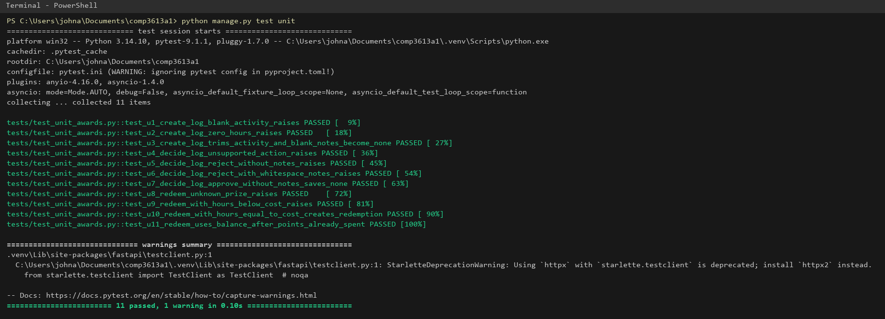

### 7.2 Integration tests report

_Screenshot of `python manage.py test integration` (21 passed):_

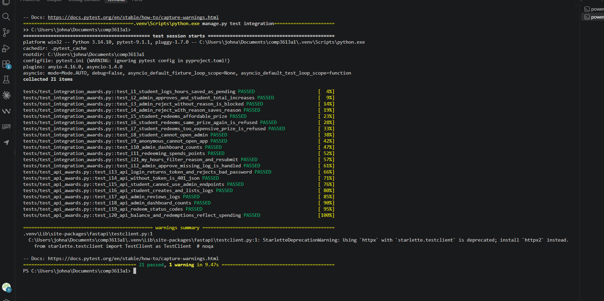

### 7.3 Postman collection run report

_Collection run with Newman, Postman's command-line collection runner: `npx newman run postman/student-awards.postman_collection.json` against a freshly seeded app. Result: 28 requests and 51 assertions, 0 failed. The full machine-readable run report is in `postman/newman-run-report.json`._

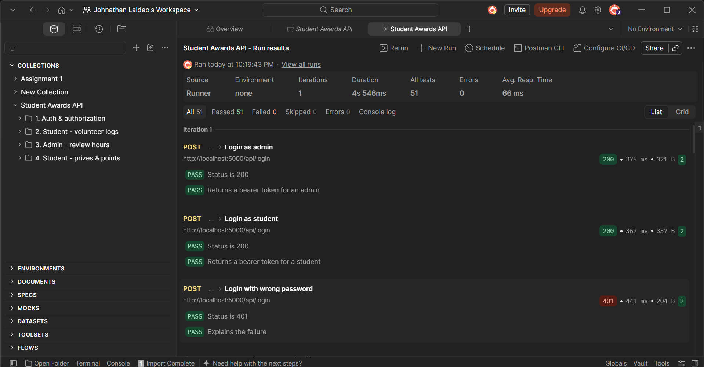

### 7.4 User Acceptance Test report

_UAT was carried out by the developer in the browser against a freshly seeded local app (`python manage.py init`), with bob in one window and admin in a private window. Actual results are recorded in section 5.1._

| Total UAT cases | Passed | Failed | Notes |
|-----------------|--------|--------|-------|
| 12 | 12 | 0 | All acceptance criteria met; no defects found. |
