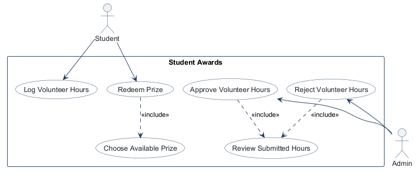
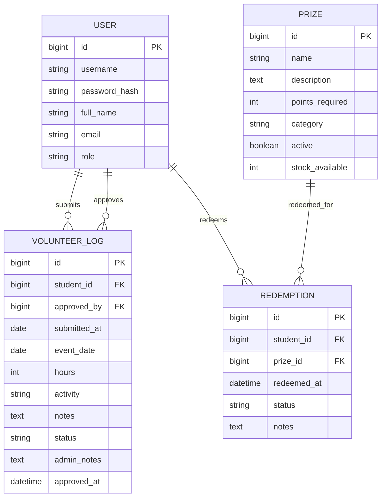
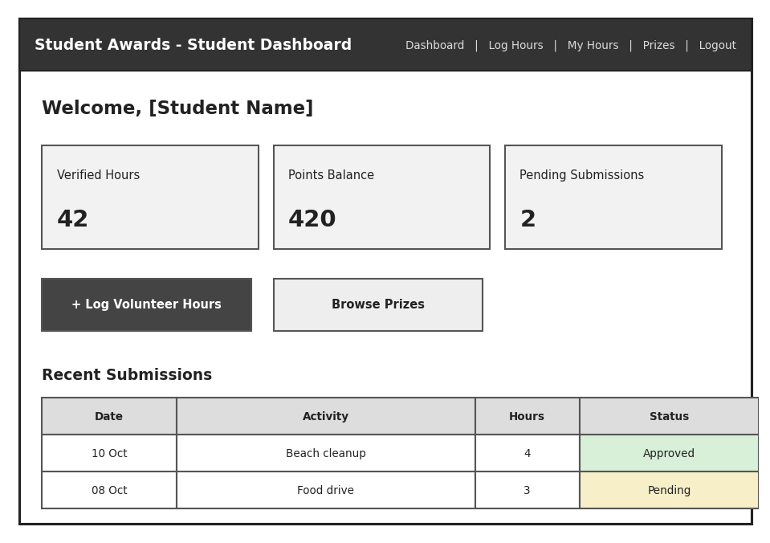
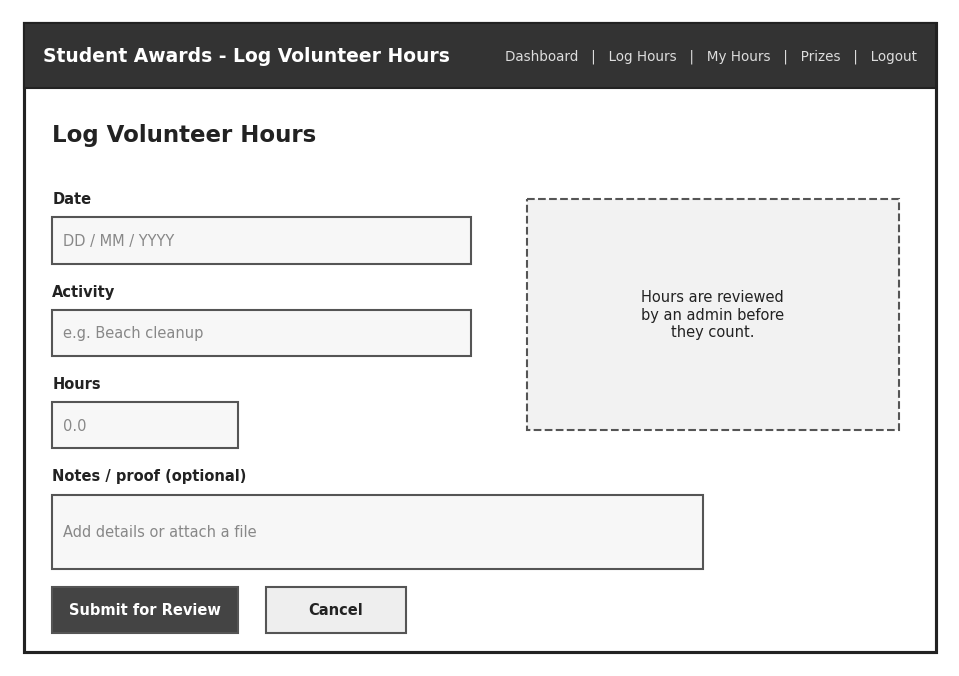
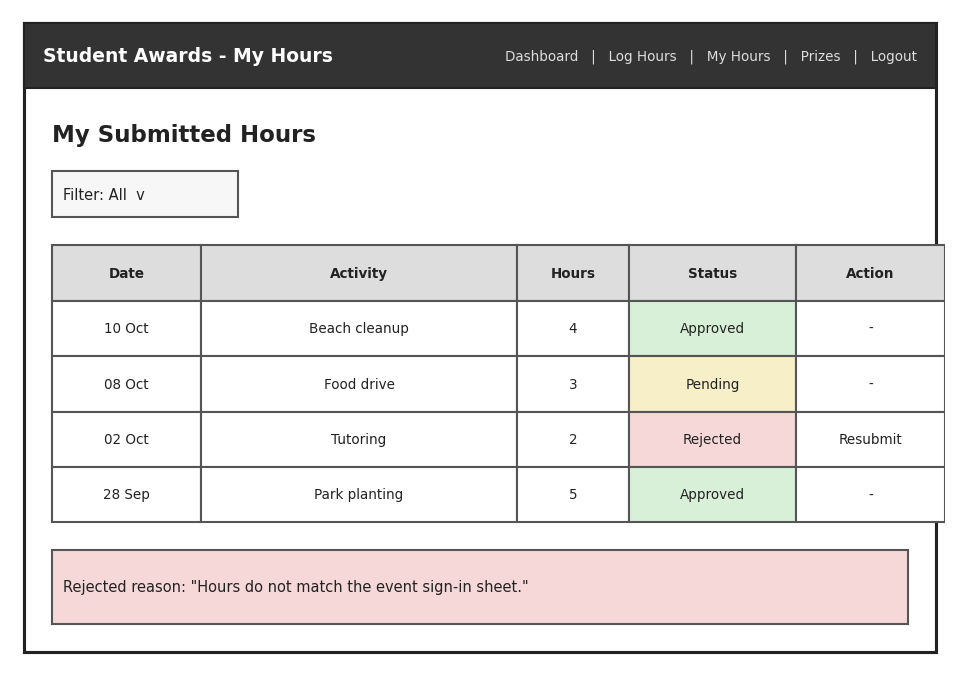
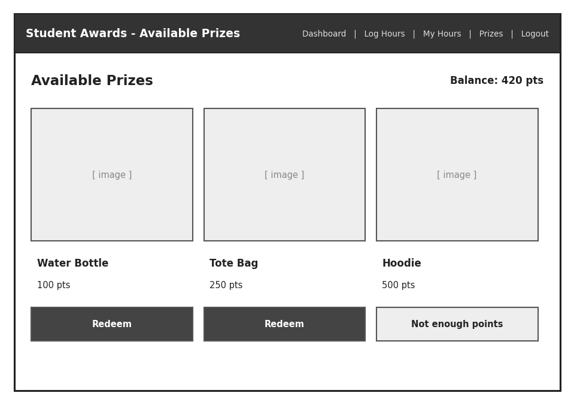
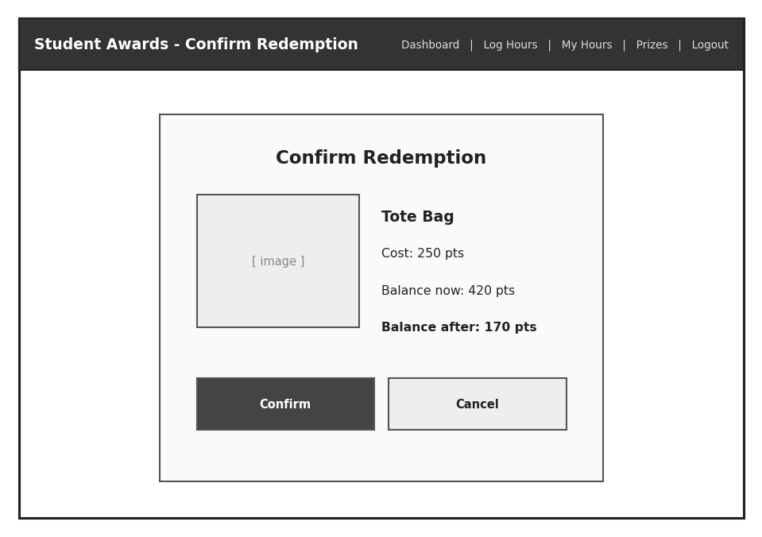
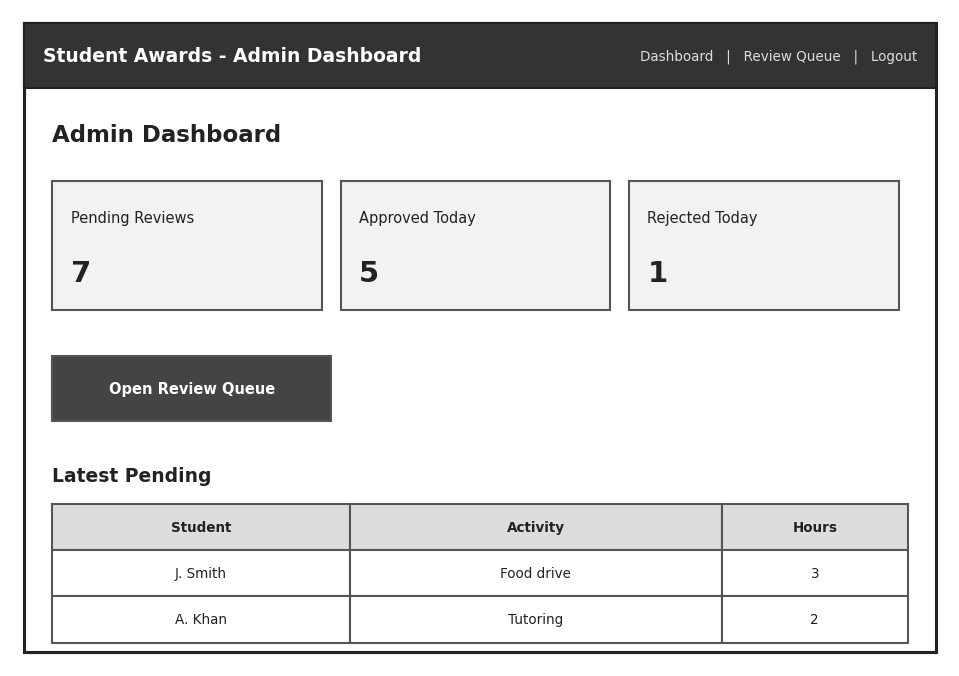
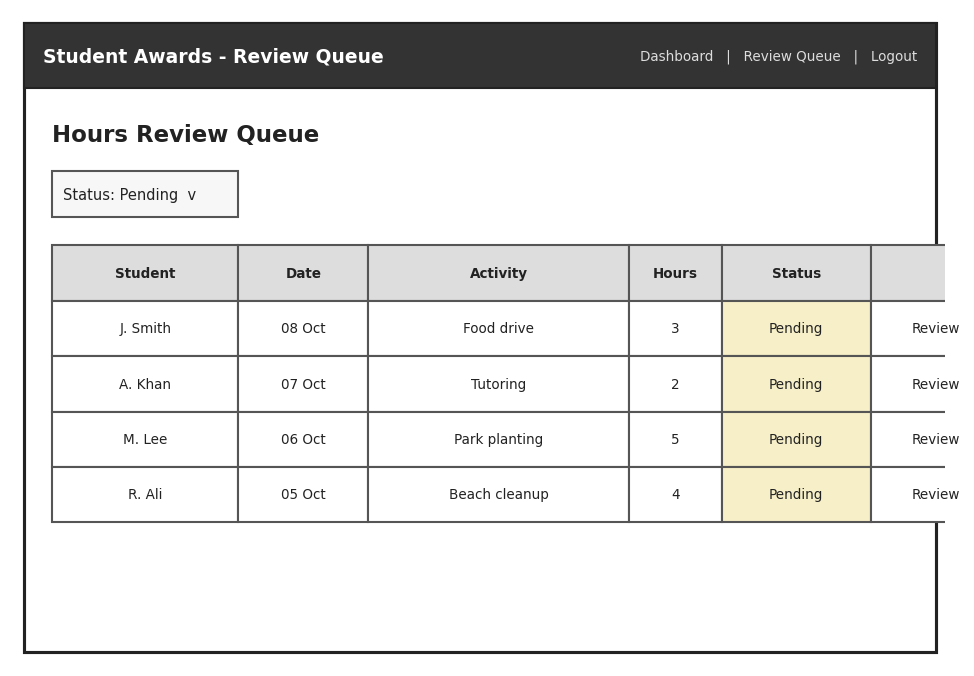
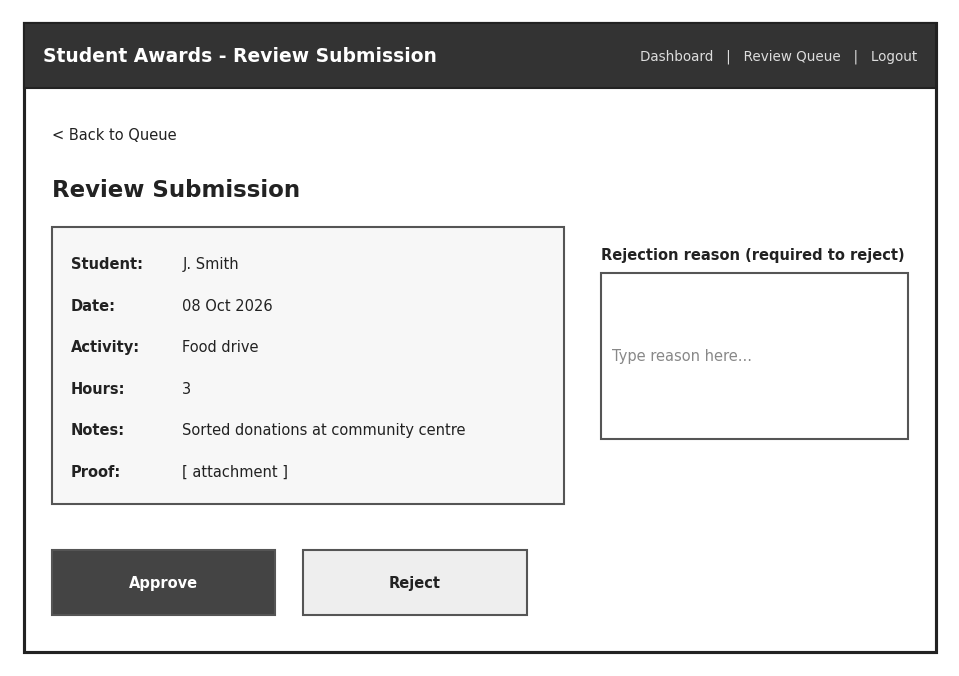

# COMP 3613 Assignment 1

Draft this file with the Guide. **Update it after every phase milestone** before you pause. The use-case diagram is a UML PNG at `docs/diagrams/use-case.png`, linked from this file as `diagrams/use-case.png` (path relative to `docs/report.md`). The model diagram is Mermaid. **Embed wireframe images** as `wireframes/<file>` (files live in `docs/wireframes/`).

Do not put your student ID in this file if you will commit it. The PDF cover adds your name and ID at export time.

## Assigned project
Student Awards

## Three workflows

### 1. Log Volunteer Hours (Student)

### 2. Approve Volunteer Hours (Admin)

### 3. Redeem Prize (Student)

## Use case diagram

Phase 2 notes: Reviewing submitted hours is included in both approval and rejection. Rejection is a separate outcome rather than an extension. Choosing an available prize is included in redemption. Students and Admins have only the role-specific use cases shown; no use cases are shared across roles.

## Model diagram

Assumes a single `User` table for both students and admins, with role-based permissions; volunteer entries are approved separately from prize redemption. This captures the three MVP workflows without adding a separate leaderboard table.

## Wireframes

### Student Dashboard

### Log Volunteer Hours (Student)

### My Hours (Student)

### Prizes (Student)

### Redeem Prize (Student)

### Admin Dashboard

### Review Queue (Admin)

### Review Submission (Admin)

Model notes for Phase 4:
- `VOLUNTEER_LOG.status` — seen on the review queue and submission review screens.
- `VOLUNTEER_LOG.admin_notes` — seen on the review submission screen.
- No new entities or relationships are required beyond the existing model draft; use-case coverage is complete and the workflow paths are legible.

<!-- student-build:wireframe-coverage
use_case: Log Volunteer Hours (Student)
image: docs/wireframes/2_log_hours.png
covered: yes
-->

<!-- student-build:wireframe-coverage
use_case: Approve Volunteer Hours (Admin)
image: docs/wireframes/7_review_queue.png
covered: yes
-->

<!-- student-build:wireframe-coverage
use_case: Redeem Prize (Student)
image: docs/wireframes/5_redeem_confirmation.png
covered: yes
-->

## Theming

Branding preferences: deep green primary, gold accent, white background, dark grey text; bold sans-serif headings with clean sans-serif body text; friendly and encouraging tone; text-only StarServe wordmark with a small star.

Applied across the public landing, login, registration, and authenticated pages.

## Implementation notes

The student dashboard has been polished against its wireframe: student navigation is in the top bar; the dashboard welcomes the signed-in student by username; action buttons are left-aligned below the summary cards; summary labels read Verified Hours, Points Balance, and Pending Submissions; Recent Submissions displays Date, Activity, Hours, and Status. The existing 1:1 verified-hour-to-point rule is retained per student direction. The student refreshed and confirmed these dashboard details now match.

Log Volunteer Hours was revised to store Activity separately from optional text Notes/proof, following the student's model and workflow choices. The form and student/admin log views use those fields; existing volunteer log descriptions are migrated to Activity at startup. The student verified the form against its wireframe and confirmed the submitted details persist and display.

The Log Volunteer Hours wireframe now has Date, Activity, Hours, an admin-review note, optional text Notes/proof, and Submit for Review / Cancel actions. The student selected text-only notes and identified the service as the layer coordinating submission validation. File uploads and fractional-hour entries are not included.

<!-- student-build:code-check
workflow: Log Volunteer Hours (Student)
form: choice
layer: service
architecture_ok: yes
implement_confidence: 0.82
passed: yes
note: Student selected the service to coordinate validation of activity and hour submissions.
-->

<!-- student-build:code-check
workflow: Log Volunteer Hours (Student)
form: snippet
layer: model
architecture_ok: yes
implement_confidence: 0.82
passed: yes
note: Student added separate required activity and optional notes fields to VolunteerLog.
-->

<!-- student-build:code-check
workflow: Log Volunteer Hours (Student)
form: snippet
layer: router
architecture_ok: yes
implement_confidence: 0.82
passed: yes
note: Student bound activity and optional notes from the form and passed them to the service.
-->

## Deployed app

Phase 6. Public Render URL (not localhost). Markers open this to mark the three workflows.

https://

## Logins

Every account a marker needs, including extra users you added. Starter accounts:

- bob / bobpass — regular user
- admin / adminpass — admin

## YouTube URL

## Session transcripts

Filled when the Guide builds the report: the agent writes each Guide chat to `docs/transcripts/<slug>.md` (Copilot Agent, Cursor, or OpenCode). `python manage.py report` packages them. Do not paste chats here during the build.

## Competency (student-judge)

Filled when the report is built. Guide runs student-judge, writes `docs/judge.md`, and export appends the scorecard here.

## Skill integrity

Filled by `python manage.py report`. Do not edit the course skills.
