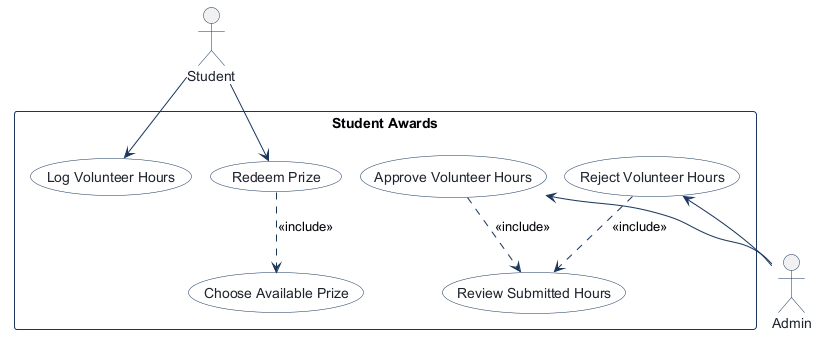
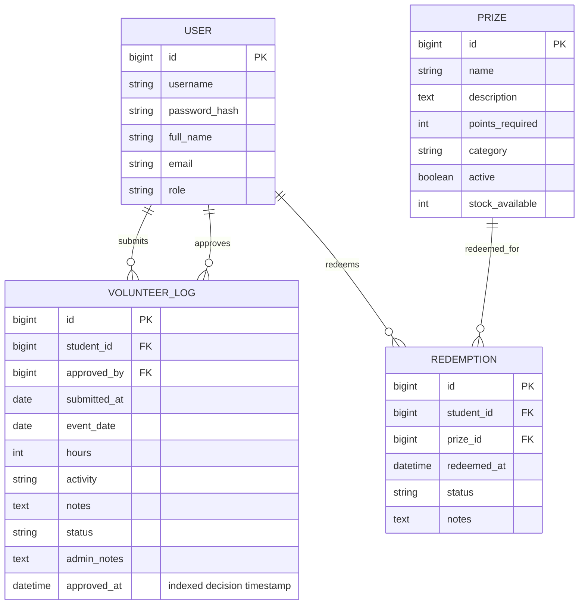
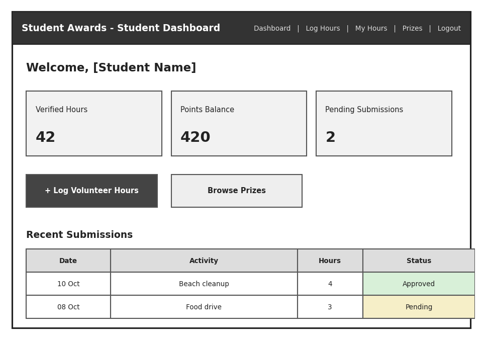
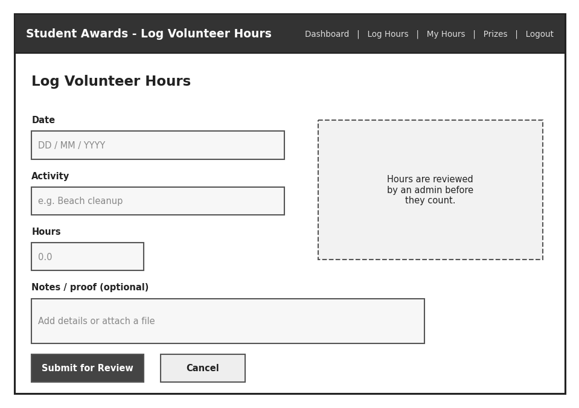
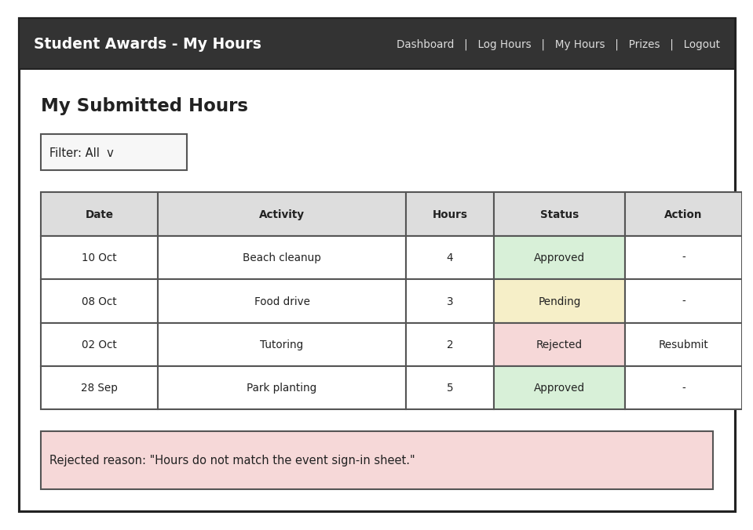
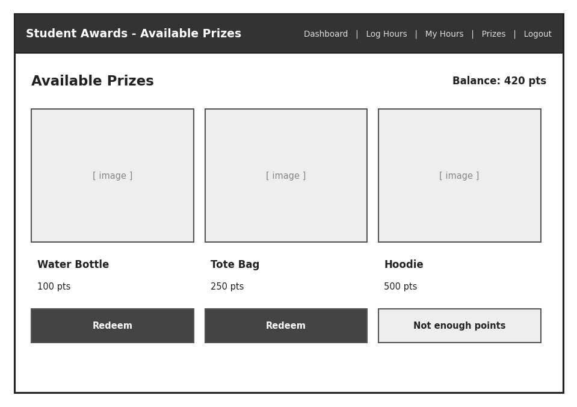
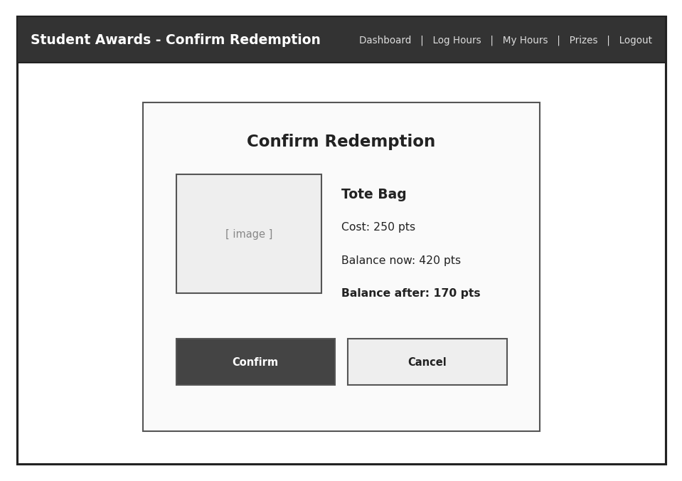
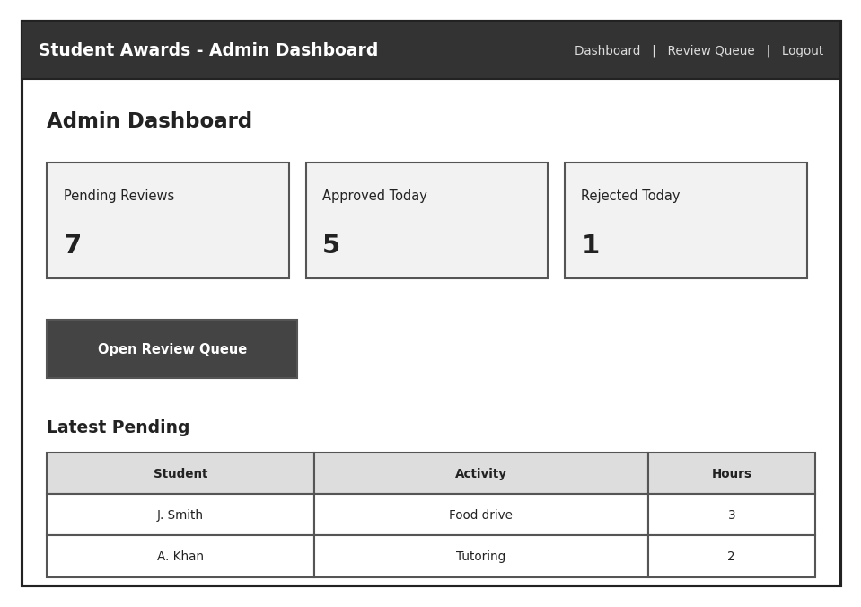
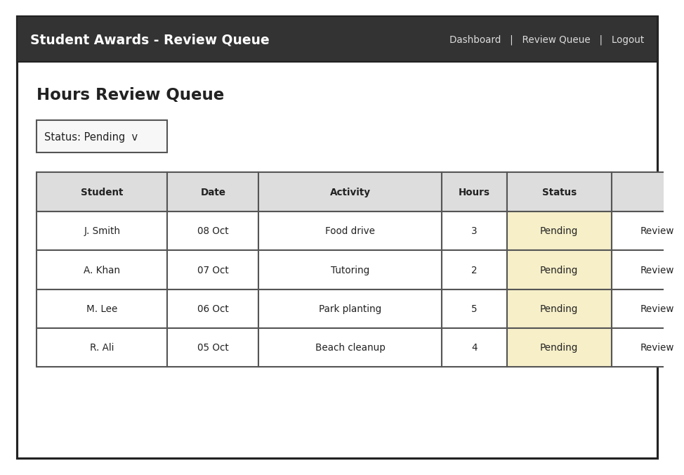
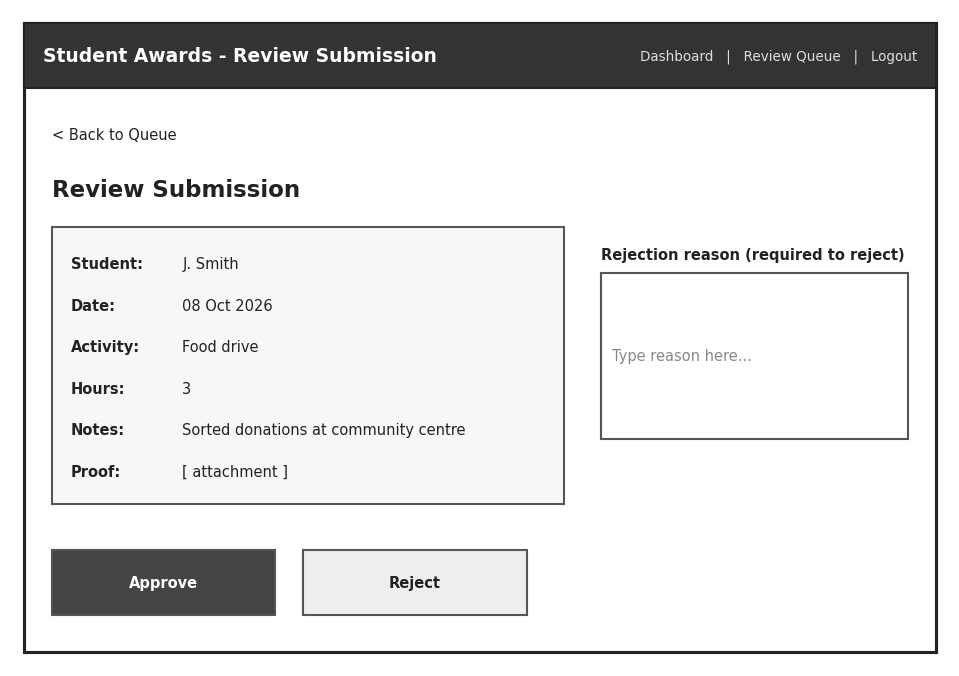

<!-- student-build:skill-integrity
status: pass
root: e84cd692d0b85eefe546385661958c27d07e8be6c5176a82012f68ccff5c8beb
expected_root: e84cd692d0b85eefe546385661958c27d07e8be6c5176a82012f68ccff5c8beb
mismatches: none
-->

# COMP 3613 Assignment 1

Draft this file with the Guide. **Update it after every phase milestone** before you pause. The use-case diagram is a UML PNG at `docs/diagrams/use-case.png`, linked from this file as `diagrams/use-case.png` (path relative to `docs/report.md`). The model diagram is Mermaid. **Embed wireframe images** as `wireframes/<file>` (files live in `docs/wireframes/`).

Do not put your student ID in this file if you will commit it. The PDF cover adds your name and ID at export time.

## Assigned project
Student Awards

## Three workflows

### 1. Log Volunteer Hours (Student)

### 2. Approve Volunteer Hours (Admin)

### 3. Redeem Prize (Student)

## Use case diagram

Phase 2 notes: Reviewing submitted hours is included in both approval and rejection. Rejection is a separate outcome rather than an extension. Choosing an available prize is included in redemption. Students and Admins have only the role-specific use cases shown; no use cases are shared across roles.

## Model diagram

Assumes a single `User` table for both students and admins, with role-based permissions; volunteer entries are approved separately from prize redemption. This captures the three MVP workflows without adding a separate leaderboard table.

## Wireframes

### Student Dashboard

### Log Volunteer Hours (Student)

### My Hours (Student)

### Prizes (Student)

### Redeem Prize (Student)

### Admin Dashboard

### Review Queue (Admin)

### Review Submission (Admin)

Model notes for Phase 4:
- `VOLUNTEER_LOG.status` — seen on the review queue and submission review screens.
- `VOLUNTEER_LOG.admin_notes` — seen on the review submission screen.
- No new entities or relationships are required beyond the existing model draft; use-case coverage is complete and the workflow paths are legible.

<!-- student-build:wireframe-coverage
use_case: Log Volunteer Hours (Student)
image: docs/wireframes/2_log_hours.png
covered: yes
-->

<!-- student-build:wireframe-coverage
use_case: Approve Volunteer Hours (Admin)
image: docs/wireframes/7_review_queue.png
covered: yes
-->

<!-- student-build:wireframe-coverage
use_case: Redeem Prize (Student)
image: docs/wireframes/5_redeem_confirmation.png
covered: yes
-->

## Theming

Branding preferences: deep green primary, gold accent, white background, dark grey text; bold sans-serif headings with clean sans-serif body text; friendly and encouraging tone; text-only StarServe wordmark with a small star.

Applied across the public landing, login, registration, and authenticated pages.

## Implementation notes

The student dashboard has been polished against its wireframe: student navigation is in the top bar; the dashboard welcomes the signed-in student by username; action buttons are left-aligned below the summary cards; summary labels read Verified Hours, Points Balance, and Pending Submissions; Recent Submissions displays Date, Activity, Hours, and Status. The existing 1:1 verified-hour-to-point rule is retained per student direction. The student refreshed and confirmed these dashboard details now match.

Log Volunteer Hours was revised to store Activity separately from optional text Notes/proof, following the student's model and workflow choices. The form and student/admin log views use those fields; existing volunteer log descriptions are migrated to Activity at startup. The student verified the form against its wireframe and confirmed the submitted details persist and display.

The admin dashboard now provides Pending Reviews, Approved Today, Rejected Today, an Open Review Queue action, and a Latest Pending table with Student, Activity, and Hours. Decision totals use the `approved_at` timestamp and UTC day boundaries; that field is indexed, with a startup migration for existing databases. Admin navigation includes Dashboard and Review Queue. The username is shown as the student label because the current User model has no separate display-name field. The student confirmed that the dashboard layout and totals match the wireframe and current records.

The review detail screen now follows the wireframe's side-by-side submission details and required rejection-reason field. The reason is validated in the service and saved in the existing admin-notes field. The student verified the review queue, detail layout, approval/rejection actions, required-reason behavior, and updated dashboard totals against the wireframes.

Prize redemption now opens a confirmation screen showing the prize, cost, current points balance, and balance after redemption. Confirm posts to the existing redemption service/repository flow; Cancel returns to the catalog. The student tested as Bob: Redeem opened the confirmation page without committing, pressing Confirm redeemed the prize, and Cancel returned to the catalog without redeeming. The student reports that redeeming points works well.

The Log Volunteer Hours wireframe now has Date, Activity, Hours, an admin-review note, optional text Notes/proof, and Submit for Review / Cancel actions. The student selected text-only notes and identified the service as the layer coordinating submission validation. File uploads and fractional-hour entries are not included.

<!-- student-build:code-check
workflow: Log Volunteer Hours (Student)
form: choice
layer: service
architecture_ok: yes
implement_confidence: 0.82
passed: yes
note: Student selected the service to coordinate validation of activity and hour submissions.
-->

<!-- student-build:code-check
workflow: Log Volunteer Hours (Student)
form: snippet
layer: model
architecture_ok: yes
implement_confidence: 0.82
passed: yes
note: Student added separate required activity and optional notes fields to VolunteerLog.
-->

<!-- student-build:code-check
workflow: Log Volunteer Hours (Student)
form: snippet
layer: router
architecture_ok: yes
implement_confidence: 0.82
passed: yes
note: Student bound activity and optional notes from the form and passed them to the service.
-->

<!-- student-build:code-check
workflow: Approve Volunteer Hours (Admin)
form: mcq
layer: service
architecture_ok: yes
implement_confidence: 0.82
passed: yes
note: Student identified the service as the layer coordinating admin dashboard summary figures.
-->

<!-- student-build:code-check
workflow: Approve Volunteer Hours (Admin)
form: snippet
layer: model
architecture_ok: yes
implement_confidence: 0.82
passed: yes
note: Student indexed the review decision timestamp used for daily approval/rejection totals.
-->

<!-- student-build:code-check
workflow: Approve Volunteer Hours (Admin)
form: snippet
layer: router
architecture_ok: yes
implement_confidence: 0.82
passed: yes
note: Student completed the approve handler by calling the service decision method.
-->

<!-- student-build:code-check
workflow: Approve Volunteer Hours (Admin)
form: choice
layer: service
architecture_ok: yes
implement_confidence: 0.82
passed: yes
note: Student chose to require a rejection reason and persist it through the existing admin-notes field.
-->

## Deployed app

Phase 6. Public Render URL (not localhost). Markers open this to mark the three workflows.

https://comp3613a1-1-9j9f.onrender.com

The student reports that `/health` returns `ok` and that login works for both `bob` and `admin`. The first Render service used the Docker runtime and did not run the seed; the replacement `comp3613a1-1` Python web service uses the existing Render Postgres database. The initial `DATABASE_URI` was incorrect and was corrected in the Render dashboard after the Render MCP tools failed to connect in VS Code.

## Logins

Every account a marker needs, including extra users you added. Starter accounts:

- bob / bobpass — regular user
- admin / adminpass — admin

## YouTube URL

https://youtu.be/cPP5_3FB4PU

## Session transcripts

Filled when the Guide builds the report: the agent writes chat markdown into `docs/transcripts/`; `python manage.py report` packages them.

Guide packaged **8** chat(s) in `docs/transcripts/` (and `docs/transcripts.zip`).

Index: [docs/transcripts/INDEX.md](transcripts/INDEX.md)

- [`phase-1-project-workflows`](transcripts/phase-1-project-workflows.md)
- [`phase-2-use-case`](transcripts/phase-2-use-case.md)
- [`phase-3-model`](transcripts/phase-3-model.md)
- [`phase-4-wireframes`](transcripts/phase-4-wireframes.md)
- [`phase-5-build-and-polish`](transcripts/phase-5-build-and-polish.md)
- [`phase-6-deployment-update`](transcripts/phase-6-deployment-update.md)
- [`phase-6-render-mcp-attempt`](transcripts/phase-6-render-mcp-attempt.md)
- [`wireframe-use-case-help`](transcripts/wireframe-use-case-help.md)

## Competency (student-judge)

Filled by Guide from the student-judge run when this report was built.

**Judged at:** 2026-10-13T01:33:38-04:00
**Evidence pass:** re-read all eight native Copilot project chats and current docs/report.md, docs/diagrams/, and docs/wireframes/; prior judge.md ignored
**Student / session:** Student Awards / Copilot Guide chats
**Artifact:** Native Copilot Guide chats and current project artefacts
**Phases in evidence:** 1–6 (COMP 3613; Phase 5 polish, Phase 6 deploy; never generic 0–5)

### Totals
| | Count / value |
|--|--|
| Metrics on rubric | 12 (M1–M12) |
| N/A (excluded) | 0 |
| Metrics scored | 12 |
| Scoreable max | 12 × 4 |
| Awarded total | 37 / 48 |
| **Overall (avg of scored)** | **3.1 / 4** |
| Impression mark | 15 / 20 |

## Scorecard

| ID | Metric | Score / 4 | In avg | Evidence |
|----|--------|----------:|:------:|----------|
| M1 | Phase discipline | 3 | yes | Phases 1–4 were separated into phase chats; Phase 5 included build and repeated polish before Phase 6 deployment work. |
| M2 | Problem framing | 3 | yes | The student selected Student Awards, named three workflows, supplied the theme, and made use-case and model choices recorded in the report. |
| M3 | Decision ownership | 3 | yes | The student steered Activity/Notes, rejection reasons, dashboard details, and redemption confirmation behavior; the agent implemented the design. |
| M4 | Artefact-before-code | 3 | yes | Use-case diagram, ERD, and eight wireframes are present and the implementation/polish notes map to those artefacts. |
| M5 | Verification habit | 4 | yes | The student reported checking each workflow; on redemption: “Clicking Redeem on the Prizes page opens the Confirm Redemption page before anything is committed” and “yes i tested it and it cancels properly.” |
| M6 | Assignment fit | 4 | yes | Phase 5 code-check markers record model/router attempts with `architecture_ok: yes`; the router snippets call services and the report records service/repository separation. |
| M7 | Slice explanation | 3 | yes | The student explained that the confirmation GET obtains prize/balance data and the redeem POST delegates checks and persistence through service/repository layers. |
| M8 | Prompt quality | 3 | yes | Prompts were phase-tagged and later steering named concrete UI, workflow, and behavior changes. |
| M9 | Response to pushback | 4 | yes | Rather than stopping at the first build, the student steered and verified dashboard, submission, admin-review, and confirmation-flow refinements. |
| M10 | Integrity | 2 | yes | There is code-seeking in Phase 5 (“okay then auto complete code for me” and “can u add in the code for me?”). The student also attempted snippets and later explained the actual flow; external assistance is not established. |
| M11 | Provenance continuity | 3 | yes | The route explanation and polish requests align with the named workflows, report, and wireframes; no orphan product or unrelated implementation was found. |
| M12 | Sincerity trajectory | 2 | yes | No `student-judge:sincerity` block was found. The code-seeking concern was not formally tested through a sincerity round, so recovery/trajectory cannot be confirmed. |

## Strengths
- The student named three workflows and supplied use-case, model, and wireframe decisions across the design phases.
- The student repeatedly steered concrete UI and workflow polish instead of accepting the first implementation.
- The student supplied per-workflow verification notes, including that Cancel returned to the catalog without redeeming.
- The code-check record shows attempted model and route snippets that respect service boundaries.
- The student explained the confirmation and redemption path in terms of route, service, and repository responsibilities.
- The student now reports a live Render deployment, healthy `/health`, and successful marker-account logins.

## Gaps (priority order)
1. **Phase 5 code-seeking leaves a limited ownership concern.** The student asked for autocomplete/paste-ready help before submitting route attempts. The record does not establish external assistance, and the student later explained the real route/service flow accurately.
2. **Sincerity trajectory is not documented.** No sincerity blocks or follow-up ownership check appear in the chats, so the concern was not formally cleared.

## Phase gate status
| Phase | Status | Note |
|-------|--------|------|
| 1 | met | Student Awards and three named workflows are recorded. |
| 2 | met | UML use-case diagram and include/reject/shared-use-case decisions are recorded. |
| 3 | met | The model diagram records the entities and relationships used for the MVP. |
| 4 | met | Eight wireframes are embedded and all three workflows have coverage. |
| 5 | met | Theme, build, verification, and iterative workflow/UI polish are recorded; code-check markers show architecture-respecting snippets. |
| 6 | met | Student supplied the public Render URL and reports `/health` returns `ok` and both `bob` and `admin` can log in. This deployment evidence is student-reported, not independently tested in this assessment. |

## Recommended next practice
- For the next code check, draft the thin route and its service/model interaction first, then explain how each line matches the existing dependencies and names before requesting implementation help.

## Integrity note
- **Concerns:** Phase 5 included requests for autocomplete and paste-ready code. The student then attempted route snippets and accurately explained the implemented flow. No evidence proves external assistance; treat this as a limited ownership concern rather than a finding of misconduct.

## Provenance flags
- Phase 5, turns 9–14: code-seeking followed by student route attempts and requests to integrate the route. No external assistance is established; the later explanation matches the application flow.

## Sincerity log summary
- Blocks found: 0 | max round: N/A | min/mean/final confidence: N/A | trend: not logged | cleared: no formal sincerity check

## Skips
- Skips: 0/3 used.

## Skill integrity

Course skills are hashed at export and compared to `.agents/skills.lock.json`. Do not edit `.agents/skills/`, `.cursor/skills/`, or `AGENTS.md`.

- Status: **pass**
- Root: `e84cd692d0b85eefe546385661958c27d07e8be6c5176a82012f68ccff5c8beb`
- none
